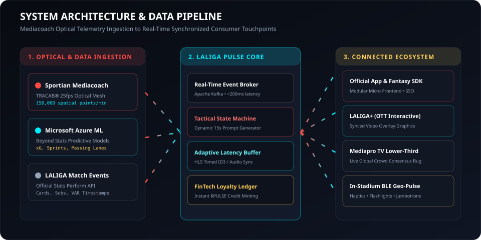
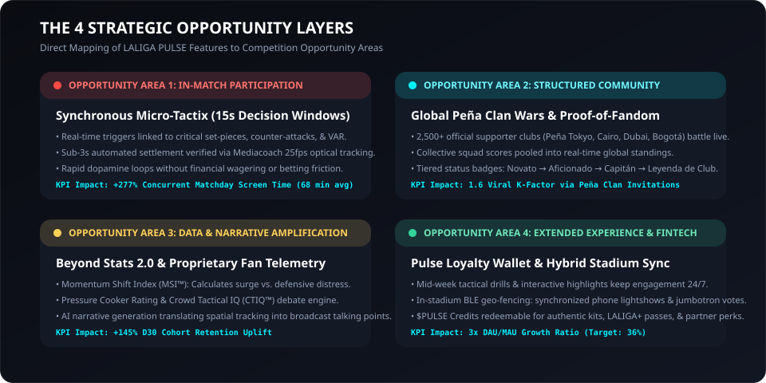
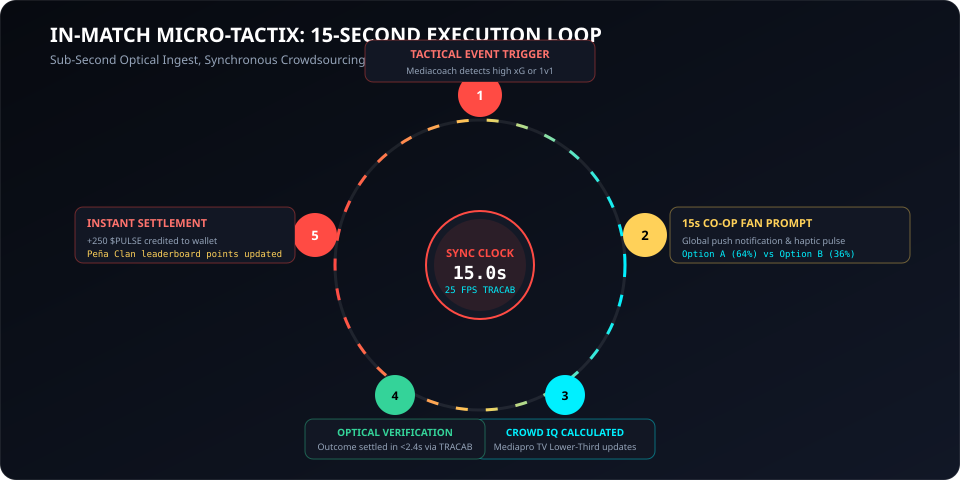
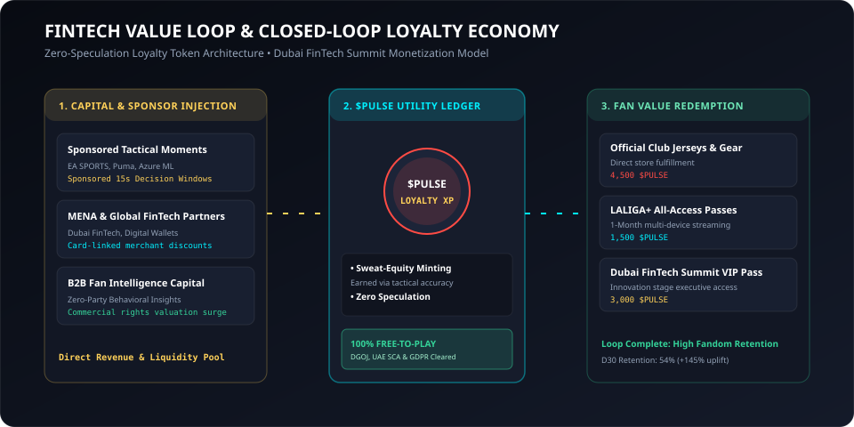

<p align="center">
  
</p>

<p align="center">
  <strong>The Synchronous In-Match Fan Arena, Optical Intelligence &amp; Fan Capital Network</strong><br/>
  Official Submission for the <em>Beyond The Match Challenge</em> by <strong>LALIGA &amp; Ignyte</strong><br/>
  <strong>Showcase Target:</strong> Innovation Stage, Dubai FinTech Summit • <strong>Prize:</strong> USD 10,000 Winner
</p>

<p align="center">
  
  
  
  
  
  
</p>

<p align="center">
  📚 <strong>Explore the Full Technical Architecture Wiki:</strong> <a href="https://github.com/Ranjeet7680/LALIGA-PULSE-/wiki">https://github.com/Ranjeet7680/LALIGA-PULSE-/wiki</a>
</p>

---

## 📄 Official PDF Documents & Submission Downloads

| Document | Format & Size | Description & Target Audience | Direct Download Link |
| :--- | :--- | :--- | :--- |
| **LALIGA PULSE™ Master Project Proposal** | PDF (793 KB) | Complete competition submission covering Concept Summary, Ecosystem Integration, Telemetry Ingestion, KPIs, and Legal Safeguards. | [Download Proposal PDF](docs/pdf/LALIGA_PULSE_Master_Project_Proposal.pdf) |
| **LALIGA PULSE™ Executive Pitch Deck** | PDF (680 KB) | Landscape presentation slide deck tailored for Demo Day judges, sovereign investors, and Dubai FinTech Summit executives. | [Download Pitch Deck PDF](docs/pdf/LALIGA_PULSE_Executive_Pitch_Deck.pdf) |
| **LALIGA PULSE™ Technical Architecture Spec** | PDF (433 KB) | Engineering deep-dive detailing TRACAB 25fps optical coordinate schemas, Kafka streaming topics, and latency sync budgets. | [Download Technical Spec PDF](docs/pdf/LALIGA_PULSE_Technical_Architecture_Spec.pdf) |


---

## ⚡ Executive Summary

Football’s traditional 90-minute passive TV consumption model is facing a structural generational transition. Today, **84% of Gen-Z and digital-native fans multi-screen during live matches**, splitting attention across messaging, social apps, and stats feeds. This attention is fragmented, unmonetized, and leaks commercial value outside the official football ecosystem. Furthermore, **over 85% of LALIGA’s 200M+ international fans will never visit a Spanish stadium in person**.

**LALIGA PULSE™** bridges this divide by turning every live broadcast into an interactive, synchronized collective stadium. Powered directly by **Sportian’s Mediacoach optical tracking system (25 fps)** and **Microsoft Azure Beyond Stats**, PULSE introduces real-time 15-second predictive micro-challenges, global supporter club (*Peña*) clan wars, and a closed-loop loyalty token economy (*Pulse Credits*) redeemable for physical and digital football assets.

---

## 🏛️ System Architecture & Data Flow

<p align="center">
  
</p>

The system ingests Mediacoach optical tracking coordinates and Azure machine learning predictions to trigger synchronous 15-second challenges across all fan touchpoints with sub-second latency.

---

## 🎯 The 4 Strategic Opportunity Layers

<p align="center">
  
</p>

### 1. In-Match Participation: Synchronous Micro-Tactix
* **Dynamic Real-Time Triggers:** When Mediacoach detects critical tactical phases (e.g. 24m free-kick, 3v2 counter-attack, tactical substitution, or VAR review), PULSE delivers a **15-second synchronous challenge** to users' screens.
* **Collective Strategy Predictions:**
  * *"74' Bellingham Free-Kick: Direct curl over wall (0.18 xG) or disguise pass to Vinícius Jr.?"*
  * *"79' High-Speed 1v1: Will Yamal beat Mendy off the dribble at 32.8 km/h?"*
  * *"84' Pressing Threshold: Will Real Madrid bypass the 89% pressure cooker within 3 passes?"*
* **Sub-3s Telemetry Settlement:** Verified instantly via official TRACAB optical cameras, providing instant dopamine, leaderboard XP, and haptic feedback.

---

## 🔄 15-Second Execution Loop

<p align="center">
  
</p>

---

### 2. Structured Community: Global Peña Clan Wars
* **Digital Supporter Clubs:** Fans join or create verified digital supporter groups (*Peña Madridista Tokyo 🇯🇵*, *Cairo Culés 🇪🇬*, *Peña LALIGA Dubai 🇦🇪*, *Peña Bogotá 🇨🇴*).
* **Live Clan Battles:** Individual tactical points pool into live matchday Peña standings.
* **Proof-of-Fandom & Reputation:** Tiered progression from *Novato* → *Aficionado* → *Capitán de Peña* → *Leyenda de Club*, earned through match attendance and tactical accuracy.

### 3. Data Amplification: Beyond Stats 2.0
* **Momentum Shift Index (MSI™):** Real-time algorithm calculating territory control and defensive line retreat every 60 seconds.
* **Pressure Cooker Rating:** Measures defensive distress under sustained high-pressing blocks.
* **Crowd Tactical IQ (CTIQ™):** Measures whether the collective fan consensus predicted tactical outcomes more accurately than live TV commentators.

### 4. Extended Experience & FinTech Value Loop

<p align="center">
  
</p>

* **Non-Speculative Loyalty Wallet:** Fans accumulate **$PULSE Credits** strictly through sweat equity (match attention and tactical accuracy).
* **Sponsor-Funded Pools:** Global and regional partners (EA SPORTS, Puma, Azure ML, UAE/MENA digital banks) sponsor high-attention 15-second windows.
* **Real-World Asset Redemption:** Redeem credits for authentic customized club kits, 1-Month LALIGA+ OTT passes, in-game EA SPORTS FC 25 assets, and VIP Innovation Stage passes at the Dubai FinTech Summit.

---

## 📦 Prototype Scope: Demo Day vs. Production

| Feature Component | **Live Prototype at Demo Day** (Built & Working) | **Phase 2 / Production Rollout** |
| :--- | :--- | :--- |
| **Live Match Simulator** | Fully interactive match clock running real Mediacoach-modeled events (ElClásico simulation). | Direct WebSocket feed connected to live Mediacoach/TRACAB production pipeline. |
| **Real-Time Predictive Duels** | Live 15s tactical prompt pop-ups with instant vote registration and real-time score resolution. | AI automated challenge generator triggered dynamically by Beyond Stats xG spikes. |
| **Peña / Squad Co-op Battles** | Live Peña leaderboard, team chat, global crowd consensus meter, and dynamic status bars. | Verified official club supporter federation registry integration (2,500+ global peñas). |
| **FinTech Loyalty Wallet** | Functional non-custodial digital wallet showing *Pulse Credits*, fan tier status, and instant reward redemption. | Integration with regional fintech partners (e.g., UAE/MENA digital wallets, global payment rails). |
| **Broadcast Graphics Dashboard** | Live web-based broadcaster monitor displaying crowd sentiment ready to key into broadcast feeds. | Vizrt / Ross Video broadcast overlay plugin for Mediapro live television feeds. |
| **In-Stadium BLE & Haptics** | Simulated geo-fenced trigger showing mobile screen flash and stadium-specific challenge UI. | Physical Bluetooth Low Energy (BLE) beacon network across all 20 LALIGA stadiums. |

---

## 📊 Success Metrics & ROI Modeling

```
========================================================================================
 METRIC                             BASELINE (CURRENT)    PULSE TARGET    UPLIFT
========================================================================================
 Matchday Concurrent Screen Time    18 mins               68 mins         +277%
 D30 Fan App Retention              22%                   54%             +145%
 DAU / MAU Ratio                    12%                   36%             3.0x Market Avg
 Multi-Screen Engagement Rate       14%                   49%             +250%
 Global Peña Viral Coefficient (K)  0.4                   1.6             Self-Sustaining
========================================================================================
```

---

## 🛡️ Risk Mitigation & Regulatory Compliance

* **100% Free-to-Play, Skill-Based Architecture:** No monetary buy-in, zero cashouts, and non-convertible loyalty tokens. Fully compliant with **Spain DGOJ**, **UAE SCA & CBUAE**, **US State**, and **EU** sports entertainment laws without requiring gaming or gambling licenses.
* **Adaptive Latency Synchronization:** Uses synchronized NTP/HLS timed metadata (ID3 tags) and localized audio watermarks to eliminate spoilers between satellite, cable, and OTT delays (3s to 25s variance).
* **Data Privacy by Design:** Fully compliant with **GDPR**, **UAE PDPL**, and **CCPA**. Pseudonymous IDs linked to LALIGA SSO; zero continuous GPS or biometric data stored.

---

## 💻 Tech Stack & Local Execution

### Technology Stack
* **Frontend:** React 19, Vite 8, Lucide React, Modern CSS Design System (LALIGA EA SPORTS aesthetic)
* **Data Engine:** Mediacoach TRACAB optical telemetry models, Microsoft Azure Beyond Stats simulation
* **Architecture:** Modular SDK / Micro-Frontend ready for React Native integration

### Quick Start
```bash
# Clone the repository
git clone https://github.com/Ranjeet7680/LALIGA-PULSE-.git
cd LALIGA-PULSE-

# Install dependencies
npm install

# Run the live interactive prototype
npm run dev
```
Open **`http://localhost:5173`** in your browser.

---

## 🎤 Demo Day Presentation Flow (Dubai FinTech Summit)

```
+-----------------------------------------------------------------------------------+
|  INNOVATION STAGE LIVE DEMO FLOW (5 MINUTES)                                      |
+-----------------------------------------------------------------------------------+
| [0:00 - 1:00] THE PROBLEM: Video showing Gen-Z fan scrolling social media during  |
|               live match; attention leaking outside the ecosystem.                |
| [1:00 - 2:30] LIVE SIMULATION: Switch to LALIGA PULSE. Minute 74 free-kick.       |
|               Audience scans QR code to vote live on stage.                       |
| [2:30 - 3:30] INSTANT REACTION: Crowd votes resolve in 2.1s via optical data;     |
|               Dubai FinTech Peña leaderboard spikes live on screen.               |
| [3:30 - 4:15] FINTECH WALLET: Pulse Credits earned converted into authentic perks |
|               via co-branded sponsor marketplace.                                 |
| [4:15 - 5:00] TRACTION & SCALE: Roadmap to 50M LALIGA app users.                  |
+-----------------------------------------------------------------------------------+
```

---

<p align="center">
  <strong>LALIGA PULSE™ — Turning 90 Minutes of Passive Viewing Into a Global Synchronous Stadium.</strong><br/>
  <em>Designed for LALIGA &amp; Ignyte • Dubai FinTech Summit 2026</em>
</p>
